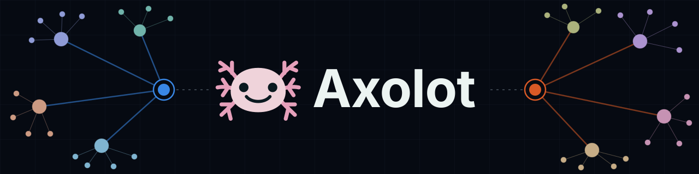
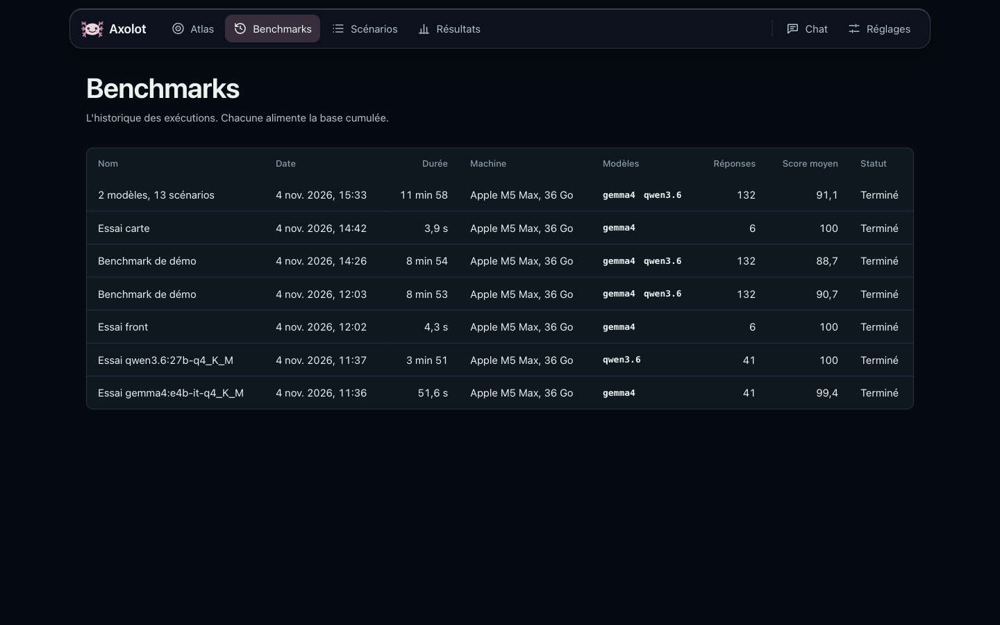

<p align="center"></p>

<h1 align="center">Axolot</h1>

<p align="center">
  <a href="#démarrer">Démarrer</a> | <a href="#parcours">Parcours</a> | <a href="#le-rag-en-bref">Le RAG en bref</a> | <a href="docs/demo.md">Présentation en 5 minutes</a>
</p>

<h3 align="center">Quel modèle pour quelle tâche, à quelle vitesse et avec quelle qualité ?</h3>

<p align="center">Labo de comparaison de modèles d'IA sur des cas à résultat attendu. Notation déterministe : aucune autre IA que les modèles testés.</p>

---

<p align="center">
  
  
  
  
  
  
  
  
</p>


## Démarrer

Prérequis : Docker avec Compose, [Ollama](https://ollama.com) sur l'hôte.

```bash
make setup   # crée .env et ses secrets, une seule fois
make up      # détecte le matériel, build et démarre
```

Interface sur http://localhost:5090, en loopback uniquement : pas d'authentification.

Modèles : à télécharger dans Réglages, qui indique lesquels conviennent à la machine et accepte tout autre nom Ollama. Pour commencer : un modèle rapide, un plus lourd pour comparer, et un modèle d'embedding pour le RAG (`bge-m3` par défaut). Après un changement de corpus : Réglages, puis Indexer.

### Claude sur abonnement

Prérequis : la CLI `claude` connectée sur l'hôte.

```bash
make bridge   # ajoute jeton et port à .env s'ils manquent, compile et lance le pont au premier plan
```

Puis Réglages, Connexions, « Connecter un compte Claude Pro ou Max » : la fenêtre explique le pont et ajoute la connexion avec le jeton (`AXOLOT_BRIDGE_TOKEN`, port `AXOLOT_BRIDGE_PORT`, 5092 par défaut). Jeton tout juste ajouté à `.env` : `make up` avant. Chaque question consomme le quota de l'abonnement. Pont en loopback uniquement : un abonnement ne se partage pas. Le pont mesure le lancement et la fermeture de Claude Code à chaque appel : les Résultats affichent des temps « Net » sans eux, et la vitesse est jugée sur ces temps nets.

## Parcours

### Atlas

Vue d'ensemble : machine, modèles, thèmes, scénarios, questions et documents reliés. Filtres dans la barre du bas, classements chiffrés, lancement et suivi d'un Benchmark en direct.

Sélectionner un modèle colore chaque question selon son résultat et rapproche les thèmes où il a le meilleur score.

Type de connexion dans la barre du bas, comme dans les Résultats : chiffres, classements et Benchmarks limités aux réponses de ce type. Le direct d'un Benchmark d'un autre type reste dans le panneau live, pas sur le graphe.

Pendant un Benchmark, ce qu'il ne touche pas s'estompe. Suivre, dans le panneau live, cadre la question en cours à chaque nouvelle question ; molette, glisser, clic sur un nœud ou Recentrer rendent la main.


### Chat

Poser une question à plusieurs modèles et comparer les réponses. Jusqu'à 4 modèles, dont 2 locaux, choisis dans les cases du haut de page et retenus d'une visite à l'autre. Les modèles locaux répondent à tour de rôle (un seul GPU), ceux du cloud en même temps. Options : documents du corpus (RAG), document ou image joints.

Serveurs MCP : bouton du même nom, serveurs HTTP ajoutés par nom, URL et jeton facultatif (chiffré comme les clés API). Un serveur qui demande une connexion (OAuth) affiche "Connexion requise" : "Se connecter" ouvre sa page dans un nouvel onglet, la connexion est gardée chiffrée. Chaque ligne affiche l'état de son serveur dès qu'il répond, ses outils sont dans le détail. L'onglet "Permissions" du détail règle chaque outil : Autorisé, Validation requise ou Bloqué (jamais proposé au modèle). Par défaut, un outil déclaré en lecture seule par son serveur est autorisé, les autres demandent une validation.

Les modèles appellent les outils des serveurs activés avant de répondre (10 tours, 30 s par appel, résultat coupé à 20 000 caractères). Chaque appel s'affiche dans la réponse avec ses arguments, sa durée et son résultat dépliable, plus le total dans les mesures (Outils : nombre d'appels et durée). Un outil en "Validation requise" met la réponse en pause jusqu'au clic sur "Autoriser", "Toujours autoriser" (l'outil passe en Autorisé) ou "Refuser" sous son appel ; un refus est signalé au modèle, qui continue. L'attente est retirée du 1er token et du total, et affichée à part (Validation : durée en attente). Un serveur injoignable, ou un modèle qui refuse les outils, est signalé sur la carte et la réponse vient sans eux. Les modèles par abonnement n'ont pas encore d'outils.


### Scénarios

Résultats côte à côte par question, vérifications, passages RAG, citation source ouvrable.

### Résultats

Quel modèle pour quelle tâche, sur toute la base : score et temps médian par thème, modèle recommandé. Plus une case est rouge, plus le modèle a perdu de points. Filtres en haut de page : type de connexion (locale, cloud par API, cloud par abonnement) et modèles ; les anciennes réponses de type inconnu ne comptent que sous « Toutes ». Un modèle cloud porte sa connexion, `(API · <nom de la connexion>)` ou `(abo)` : servi par deux connexions, il compte comme deux modèles. Renommer une connexion API sépare ses nouvelles réponses des anciennes.


### Benchmarks

Historique des exécutions, chacune alimente la base cumulée. Détail en onglets Résumé, Temps, Réponses, Qualimétrie.



### Réglages

Machine, connexions, bibliothèque de modèles, corpus et indexation.

## Le RAG en bref

Faire répondre un modèle à partir de nos documents, sans l'entraîner dessus : on lui passe les bons passages avec la question.

**Indexation** (Réglages, puis Indexer) :
1. **Extraction** du texte : Word, PDF, Excel, PowerPoint, mail, Markdown, texte (`internal/rag/extract*.go`).
2. **Chunking** : découpe en morceaux (800 caractères par défaut), avec un overlap (120 par défaut) pour ne pas couper une idée en deux. La coupe se fait de préférence entre paragraphes, puis entre phrases.
3. **Embedding** : le modèle d'embedding (`bge-m3` par défaut), via Ollama, transforme chaque chunk en vecteur qui représente son sens.
4. **Stockage** : vecteurs dans PostgreSQL avec pgvector.

**À chaque question** :
1. La question devient un vecteur, avec le même modèle.
2. **Retrieval** : les chunks les plus proches (top K, 5 par défaut, similarité cosinus, recherche exacte).
3. **Génération** : le modèle reçoit ces chunks et la question, avec la consigne de répondre uniquement à partir d'eux, de citer le fichier et de dire s'il ne sait pas.

**Notation** : sur les scénarios RAG, on contrôle sans IA que le bon passage a été retrouvé, que la source est citée et que la réponse est juste. Tous les modèles lisent les mêmes chunks, donc l'écart vient du modèle.

**Pas encore fait** : recherche hybride (mots-clés et vecteurs), reranking, OCR des PDF scannés. Le prompt annonce aussi les pièges (version la plus récente, bonne entité), ce qui aide les modèles.

Taille des chunks, overlap, top K et modèle d'embedding se règlent dans Réglages ; il faut réindexer après un changement du corpus, de la taille, de l'overlap ou du modèle. Code : `internal/rag/rag.go`.

## Développement

```bash
make dev        # Vite avec hot reload sur http://localhost:5191
make test       # tests Go, base comprise
make lint       # gofmt + go vet
make web-check  # svelte-check
```

État du POC : `docs/poc.md`.

## Contributions

- Une branche courte par sujet, créée depuis `main`, par exemple `AXO-frontier-claude-bridge` : préfixe du projet, n° de l'issue si un outil de suivi est utilisé (Linear, Jira), puis un slug court.
- Une PR de 400 à 500 lignes de code au plus, tests compris.
- `make lint`, `make test` et `make web-check` (si le front change) au vert avant chaque commit et chaque PR.
- `main` reste utilisable (`make up` fonctionne) : pas de push direct ni de force-push, tout passe par une PR.
- Fusion par un humain uniquement ; à plusieurs, le relecteur n'est pas l'auteur.

## Usage de l'IA

Les agents IA (Claude Code) sont autorisés, avec les règles de `CLAUDE.md` (conventions et pièges, utiles aussi sans agent). Leurs PR s'ouvrent en brouillon ; passer en « prête » et fusionner restent des actions humaines.
