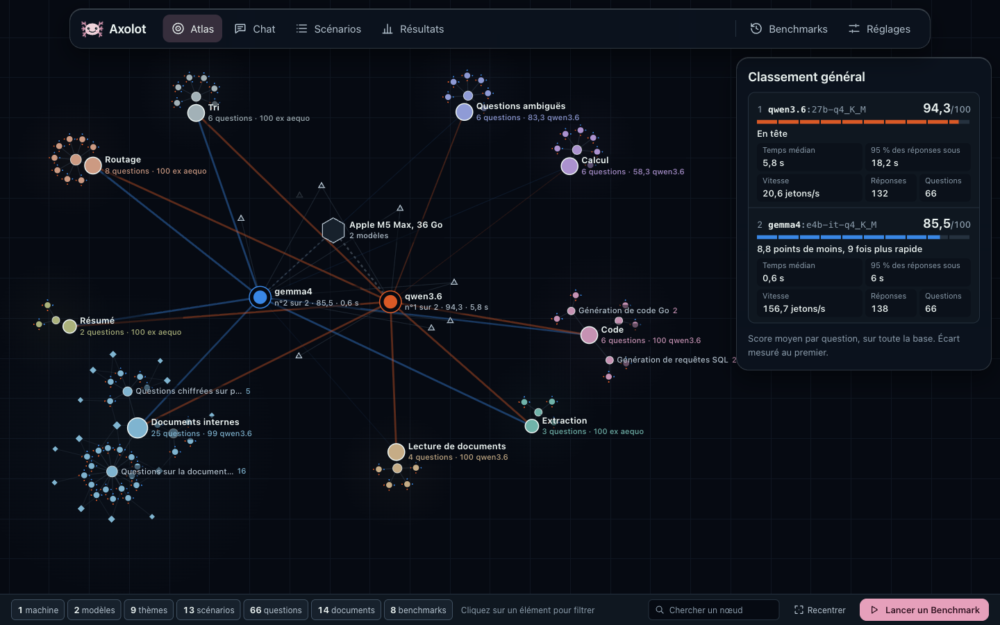
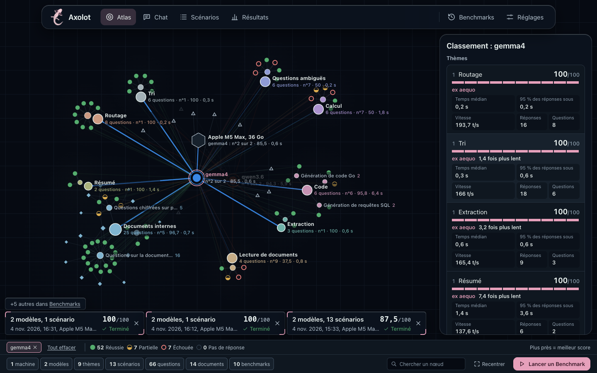

# Axolot

Labo de comparaison de modèles d'IA sur des cas à résultat attendu. Quel modèle pour quelle tâche, à quelle vitesse et avec quelle qualité, sur la machine présente. Notation déterministe : aucune autre IA que les modèles testés.



**Présenter Axolot :** parcours de 5 minutes dans [docs/demo.md](docs/demo.md).

## Démarrer

Prérequis : Docker avec Compose, [Ollama](https://ollama.com) sur l'hôte.

```bash
make setup   # crée .env et ses secrets, une seule fois
make up      # détecte le matériel, build et démarre
```

Interface sur http://localhost:5090, en loopback uniquement : pas d'authentification.

## Parcours

- **Carte** : modèles, machines et thèmes reliés, filtres, classements chiffrés, lancement et suivi d'un Benchmark en direct.
- **Benchmarks** : historique des exécutions, détail en onglets Résumé, Temps, Réponses, Qualimétrie.
- **Cas** : résultats côte à côte par question, vérifications, passages RAG, citation source ouvrable.
- **Résultats** : graphiques et tableau complet.
- **Réglages** : machine, connexions, bibliothèque de modèles, corpus et indexation.

Modèles : `gemma4:e4b-it-q4_K_M`, `qwen3.6:27b-q4_K_M`, `bge-m3` pour les embeddings. Après un changement de corpus : Réglages, puis Indexer.

## Le RAG en bref

Faire répondre un modèle à partir de nos documents, sans l'entraîner dessus : on lui passe les bons passages avec la question.

**Indexation** (Réglages, puis Indexer) :
1. **Extraction** du texte : Word, PDF, Excel, PowerPoint, mail, Markdown, texte (`internal/rag/extract*.go`).
2. **Chunking** : découpe en morceaux de 800 caractères, avec 120 d'overlap pour ne pas couper une idée en deux. La coupe se fait de préférence entre paragraphes, puis entre phrases.
3. **Embedding** : `bge-m3`, via Ollama, transforme chaque chunk en vecteur qui représente son sens.
4. **Stockage** : vecteurs dans PostgreSQL avec pgvector.

**À chaque question** :
1. La question devient un vecteur, avec le même modèle.
2. **Retrieval** : les 5 chunks les plus proches (top K, similarité cosinus, recherche exacte).
3. **Génération** : le modèle reçoit ces chunks et la question, avec la consigne de répondre uniquement à partir d'eux, de citer le fichier et de dire s'il ne sait pas.

**Notation** : sur les scénarios RAG, on contrôle sans IA que le bon passage a été retrouvé, que la source est citée et que la réponse est juste. Tous les modèles lisent les mêmes chunks, donc l'écart vient du modèle.

**Pas encore fait** : recherche hybride (mots-clés et vecteurs), reranking, OCR des PDF scannés. Le prompt annonce aussi les pièges (version la plus récente, bonne entité), ce qui aide les modèles.

Taille des chunks, overlap, top K et modèle d'embedding se règlent dans Réglages ; il faut réindexer après un changement du corpus, de la taille, de l'overlap ou du modèle. Code : `internal/rag/rag.go`.

## Développement

```bash
make dev        # Vite avec hot reload sur http://localhost:5191
make test       # tests Go, base comprise
make lint       # gofmt + go vet
make web-check  # svelte-check
```

Conventions et pièges : `CLAUDE.md`. État du POC : `docs/poc.md`.




