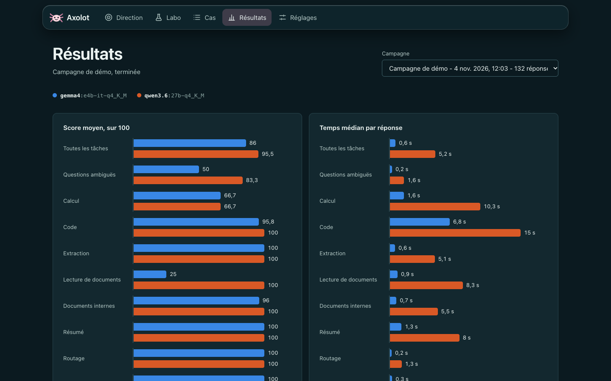
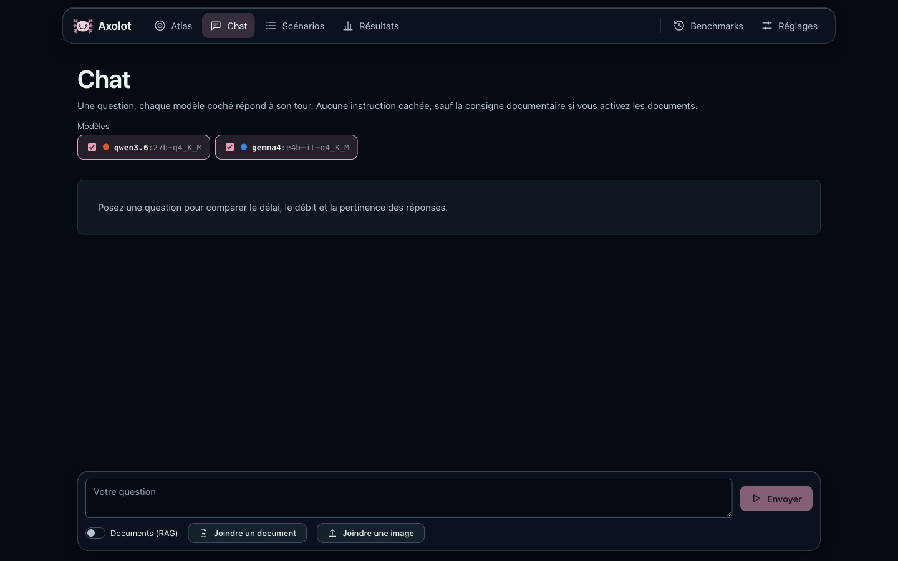

# Axolot

Labo de comparaison de modèles d'IA sur des cas à résultat attendu. Quel modèle pour quelle tâche, à quelle vitesse et avec quelle qualité, sur la machine présente. Notation déterministe : aucune autre IA que les modèles testés.


**Présenter Axolot :** parcours de 5 minutes dans [docs/demo.md](docs/demo.md).

## Démarrer

Prérequis : Docker avec Compose, [Ollama](https://ollama.com) sur l'hôte.

```bash
make setup   # crée .env et ses secrets, une seule fois
make up      # détecte le matériel, build et démarre
```

Interface sur http://localhost:5090, en loopback uniquement : pas d'authentification.

## Parcours

- **Carte** : modèles, machines et thèmes reliés, filtres, classements chiffrés, lancement et suivi d'un Benchmark en direct.
- **Benchmarks** : historique des exécutions, détail en onglets Résumé, Temps, Réponses, Qualimétrie.
- **Cas** : résultats côte à côte par question, vérifications, passages RAG, citation source ouvrable.
- **Résultats** : graphiques et tableau complet.
- **Réglages** : machine, connexions, bibliothèque de modèles, corpus et indexation.

Modèles : `gemma4:e4b-it-q4_K_M`, `qwen3.6:27b-q4_K_M`, `bge-m3` pour les embeddings. Après un changement de corpus : Réglages, puis Indexer.

## Développement

```bash
make dev        # Vite avec hot reload sur http://localhost:5191
make test       # tests Go, base comprise
make lint       # gofmt + go vet
make web-check  # svelte-check
```

Conventions et pièges : `CLAUDE.md`. État du POC : `docs/poc.md`.






